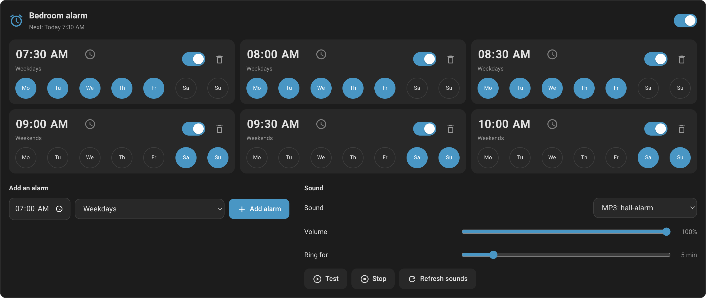

# AWTRIX NG alarm card

Alarm clock for the Bedroom TC002. `type: custom:awtrix-ng-alarm-card`



- Add alarms with a time and days, change them, switch them on or off, and delete them (tap the bin, then **Delete?**).
- A master switch turns all alarms on or off, and a line shows the next alarm.
- Sound settings: the sound list, an MP3 address, a spoken phone message, volume and how long it rings, plus **Test**, **Stop** and **Refresh sounds**.

**The card doesn't ring the alarm itself.** It edits Home Assistant helpers. The **TC002 – Alarm clock** automation checks them once a minute and runs **TC002 – Ring alarm**.

## Install

You need the TC002 helpers, scripts and automations first (see [Options](#options)).

1. Build it from the repo root: `PKG=awtrix-ng-alarm-card npm run build`.
2. Copy `dist/awtrix-ng-alarm-card.js` to `/config/www/` (File editor works).
3. Go to **Settings → Dashboards → ⋮ → Resources → Add resource**:
   - URL: `/local/awtrix-ng-alarm-card.js?v=1.1.0`
   - Type: **JavaScript module**
4. Hard-refresh the browser. In the phone app, use **Settings → Companion app → Debugging → Reset frontend cache**.

When you update, change the `?v=` number so browsers load the new file.

## Options

```yaml
type: custom:awtrix-ng-alarm-card
title: Bedroom alarm
```

Every option is a helper, script or automation. They all default to the TC002 ones.

| Option                 | Default                                 | What it holds                                                                                                    |
| ---------------------- | --------------------------------------- | ---------------------------------------------------------------------------------------------------------------- |
| `alarms_entity`        | `input_text.tc002_alarms`               | The alarms, as `HHMM:days:on` items, comma separated (days `1` = Mon … `7` = Sun), e.g. `0730:12345:1,0900:67:0` |
| `enabled_entity`       | `input_boolean.tc002_alarms_enabled`    | Master on/off                                                                                                    |
| `sound_entity`         | `input_select.tc002_alarm_sound`        | The alarm sound. `MP3 from URL` and `Phone: spoken message` show extra fields.                                   |
| `volume_entity`        | `input_number.tc002_alarm_volume`       | Volume (%)                                                                                                       |
| `ring_time_entity`     | `input_number.tc002_alarm_ring_time`    | Ring time (min)                                                                                                  |
| `mp3_entity`           | `input_text.tc002_alarm_mp3`            | MP3 address                                                                                                      |
| `phone_message_entity` | `input_text.tc002_alarm_phone_message`  | Spoken message                                                                                                   |
| `phone_repeat_entity`  | `input_number.tc002_alarm_phone_repeat` | How long the phone message repeats (min)                                                                         |
| `ring_script`          | `script.tc002_ring_alarm`               | Ring now (also used by **Test**)                                                                                 |
| `stop_script`          | `script.tc002_stop_alarm`               | Stop                                                                                                             |
| `refresh_automation`   | `automation.tc002_refresh_alarm_sounds` | Re-reads the sounds stored on the clock                                                                          |

The `input_text` holds 255 characters, so about 15–20 alarms. The card tells you when it's full.
