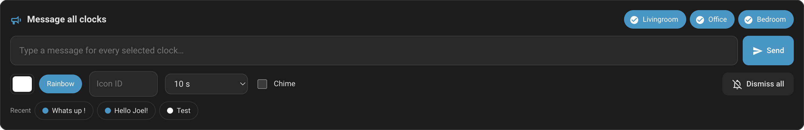

# AWTRIX NG "Message all clocks" card

One message box that sends to several AWTRIX NG clocks at once. `type: custom:awtrix-ng-broadcast-card`



- A chip for each clock picks which ones get the message. Offline clocks are crossed out (live status needs an admin user).
- Colour or rainbow text, an icon, how long it shows, a chime, **Dismiss all**, and your last 6 messages.
- It remembers your clock picks and message style, per browser.

## Install

You need the MQTT integration, and each clock running AWTRIX NG with MQTT and HA discovery on.

1. Build it from the repo root: `PKG=awtrix-ng-broadcast-card npm run build`.
2. Copy `dist/awtrix-ng-broadcast-card.js` to `/config/www/` (File editor works).
3. Go to **Settings → Dashboards → ⋮ → Resources → Add resource**:
   - URL: `/local/awtrix-ng-broadcast-card.js?v=1.1.0`
   - Type: **JavaScript module**
4. Hard-refresh the browser. In the phone app, use **Settings → Companion app → Debugging → Reset frontend cache**.

When you update, change the `?v=` number so browsers load the new file.

## Options

```yaml
type: custom:awtrix-ng-broadcast-card
title: Message all clocks # optional
clocks: # optional: leave out to use every clock found
  - prefix: awtrix_clock_1
    name: Livingroom
  - prefix: awtrix_clock_2
    name: Office
  - prefix: awtrix3
    name: Bedroom
```

Without `clocks`, it uses every clock that has an "MQTT prefix" sensor (from AWTRIX HA discovery).

In a Sections dashboard, set the section to span the full width so the card sits across the top.
