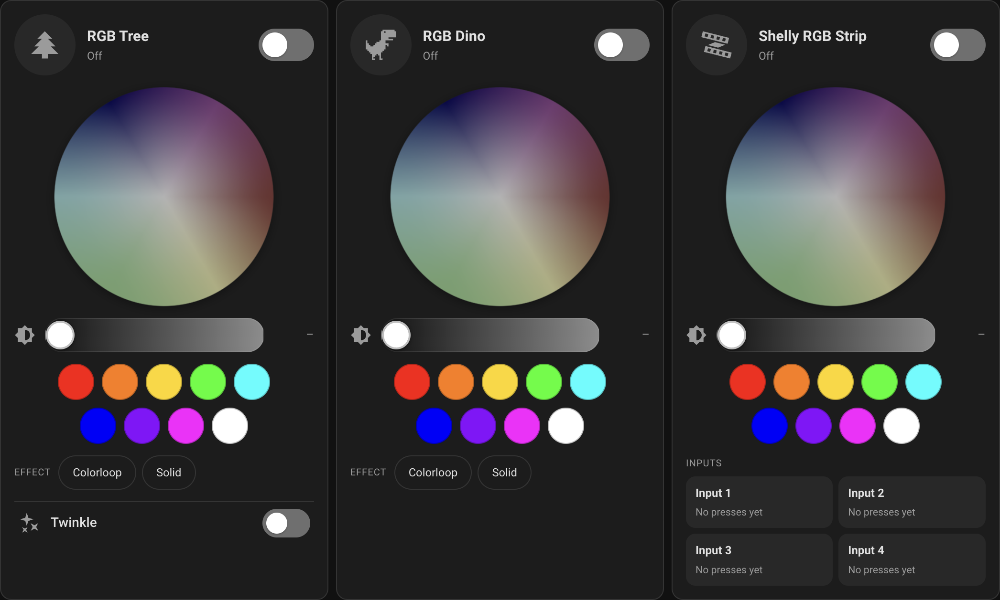

# RGB Light Card

A Home Assistant dashboard card for **colour lights**: RGB, RGBW and RGBWW, such as the Shelly RGBW PM, WLED or ESPHome strips.



- **A colour wheel** you drag to pick a colour. The light changes live while you drag.
- **A brightness slider** that shows the light's current colour.
- **Favourite colours:** Red, Orange, Yellow, Green, Cyan, Blue, Purple, Magenta and White, or your own. The one in use is outlined. On RGBW lights, **White** uses the real white LEDs.
- **Effect** chips, if the light has effects.
- **Extra switches**, e.g. a "Twinkle" mode that's a separate switch entity.
- **Button inputs**, such as a Shelly's inputs. Each shows its last press (single, double, triple or long) and how long ago it was.

## Install

Build it from the repo root (`PKG=rgb-light-card npm run build`), then follow **Deploy a card** in the [root README](../../README.md). The file is `dist/rgb-light-card.js`.

## Options

```yaml
type: custom:rgb-light-card
entity: light.led_strip # required
name: LED Strip # optional
icon: mdi:led-strip-variant # optional
switches: # optional: extra toggles shown on the card
  - entity: switch.led_strip_twinkle
    name: Twinkle
    icon: mdi:shimmer # optional
inputs: # optional: event entities (button inputs)
  - entity: event.led_strip_input_0
    name: Button 1
hide_effects: [rainbow, wipe] # optional: effects you don't want buttons for
favorites: # optional: replaces the default nine
  - { name: Red, color: "#FF0000" }
  - { name: White, color: white } # "white" uses the white LEDs on RGBW / RGBWW lights
```

| Option         | Default     | What it does                                                                            |
| -------------- | ----------- | --------------------------------------------------------------------------------------- |
| `entity`       | required    | A light with a colour mode (`rgb`, `rgbw`, `rgbww`, `hs` or `xy`).                      |
| `name`         | entity name | Card title.                                                                             |
| `icon`         | entity icon | Any `mdi:` icon.                                                                        |
| `switches`     | none        | Extra on/off rows. Each item is an entity id, or `entity` + optional `name` and `icon`. |
| `inputs`       | none        | `event.*` entities shown as buttons with their last press. Same format as `switches`.   |
| `hide_effects` | none        | Effect names to leave out (not case-sensitive).                                         |
| `favorites`    | 9 colours   | List of `name` + `color` (`#RRGGBB` or `white`).                                        |
